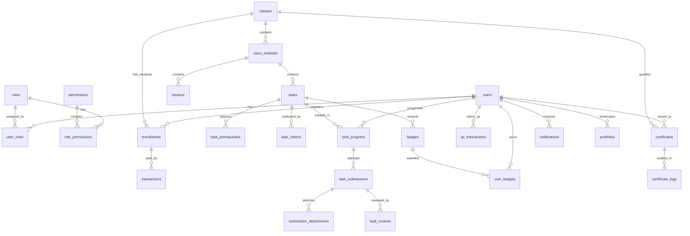

# DATABASE SCHEMA SPECIFICATION & ERD — UNEED ACADEMY

## 1. Database Architecture & Design Principles
- **Engine**: TiDB Cloud (kompatibel dengan MySQL 8.0, TLS connection, serverless connection pooling).
- **ORM**: Drizzle ORM (`drizzle-orm/mysql2`).
- **Data Integrity**:
  - Seluruh timestamp disimpan dalam format **UTC** dan dikonversi ke **Asia/Jakarta (WIB)** saat ditampilkan.
  - Nilai moneter/transaksi menggunakan tipe **`DECIMAL(12, 2)`** (bukan floating point).
  - Enforce constraint unik gabungan untuk mencegah duplikasi progress, perolehan badge, enrollment, dan sertifikat.
  - Soft delete (`deleted_at`) pada entitas utama kelas, modul, tugas, dan pengguna.

---

## 2. Entity Relationship Diagram (ERD)

---

## 3. Table Definitions

### Authentication & Users
- `users`: `id`, `name`, `username`, `email`, `phone_number`, `password_hash`, `avatar_url`, `is_email_verified`, `status` (`active`, `suspended`), `created_at`, `updated_at`, `deleted_at`.
- `roles`: `id`, `name` (`super_admin`, `mentor`, `student`), `description`, `created_at`.
- `user_roles`: `user_id`, `role_id`, `created_at` (Composite Primary Key).
- `email_verification_tokens`: `id`, `user_id`, `token_hash`, `expires_at`, `created_at`.
- `password_reset_tokens`: `id`, `user_id`, `token_hash`, `is_used`, `expires_at`, `created_at`.

### Class & Curriculum
- `categories`: `id`, `name`, `slug`, `icon`, `description`, `created_at`.
- `classes`: `id`, `category_id`, `title`, `slug`, `short_description`, `full_description`, `thumbnail_url`, `banner_url`, `difficulty` (`beginner`, `intermediate`, `advanced`), `price` (DECIMAL), `discount_price` (DECIMAL), `estimated_duration_hours`, `learning_outcomes` (JSON), `prerequisites` (JSON), `tools_required` (JSON), `status` (`draft`, `published`, `archived`), `version`, `created_at`, `updated_at`, `deleted_at`.
- `class_mentors`: `class_id`, `mentor_id`, `assigned_at` (Composite PK).
- `class_modules`: `id`, `class_id`, `title`, `description`, `order_index`, `created_at`, `updated_at`.
- `lessons`: `id`, `module_id`, `title`, `slug`, `content_type` (`text`, `video`, `pdf`), `content_body`, `video_url`, `attachment_url`, `order_index`, `estimated_minutes`, `created_at`, `updated_at`.
- `tasks`: `id`, `module_id`, `title`, `slug`, `task_type` (`reading`, `coding`, `project`, `quiz`, `research`, `deployment`, `final_project`), `description`, `instructions`, `reference_materials`, `ai_prompt`, `submission_types` (JSON: text, github, live_url, file, etc.), `min_passing_score`, `max_score`, `estimated_duration_minutes`, `order_index`, `is_required`, `validation_method` (`manual_mentor`, `auto_quiz`, `confirmation`), `xp_reward`, `badge_id`, `status` (`draft`, `published`), `created_at`, `updated_at`.
- `task_prerequisites`: `task_id`, `prerequisite_task_id` (Composite PK).
- `task_rubrics`: `id`, `task_id`, `title`, `description`, `weight`, `max_points`.

### Enrollments & Transactions
- `enrollments`: `id`, `user_id`, `class_id`, `status` (`pending`, `active`, `completed`, `expired`, `suspended`, `revoked`), `progress_percentage`, `completed_tasks_count`, `total_required_tasks`, `enrolled_at`, `completed_at`, `created_at`, `updated_at` (Unique: `user_id` + `class_id`).
- `transactions`: `id`, `user_id`, `class_id`, `enrollment_id`, `order_id`, `payment_method` (`midtrans`, `manual_transfer`, `free`), `amount` (DECIMAL), `status` (`pending`, `waiting_verification`, `paid`, `failed`, `expired`, `rejected`, `cancelled`), `payment_proof_url`, `rejection_reason`, `snap_token`, `paid_at`, `verified_by_user_id`, `created_at`, `updated_at`.

### Learning Engine & Submissions
- `lesson_progress`: `id`, `user_id`, `lesson_id`, `is_completed`, `completed_at` (Unique: `user_id` + `lesson_id`).
- `task_progress`: `id`, `user_id`, `task_id`, `class_id`, `status` (`locked`, `available`, `in_progress`, `submitted`, `under_review`, `revision_required`, `completed`), `highest_score`, `unlocked_at`, `completed_at`, `created_at`, `updated_at` (Unique: `user_id` + `task_id`).
- `task_submissions`: `id`, `task_progress_id`, `user_id`, `task_id`, `attempt_number`, `title`, `description`, `github_url`, `live_url`, `notes`, `status` (`submitted`, `approved`, `revision_required`), `submitted_at`, `reviewed_at`.
- `submission_attachments`: `id`, `submission_id`, `file_name`, `file_url`, `file_size`, `mime_type`, `created_at`.
- `task_reviews`: `id`, `submission_id`, `mentor_id`, `score`, `feedback`, `status` (`approved`, `revision_required`), `reviewed_at`.

### Gamification & Certificates
- `badges`: `id`, `name`, `slug`, `description`, `icon_name`, `image_url`, `rarity` (`common`, `rare`, `epic`, `legendary`), `color_hex`, `xp_reward`, `created_at`.
- `user_badges`: `id`, `user_id`, `badge_id`, `task_id`, `earned_at` (Unique: `user_id` + `badge_id`).
- `xp_transactions`: `id`, `user_id`, `amount`, `source_type` (`task_completion`, `class_completion`, `streak`, `bonus`), `source_id`, `description`, `created_at`.
- `user_streaks`: `id`, `user_id`, `current_streak`, `longest_streak`, `last_activity_date`, `updated_at`.
- `certificates`: `id`, `certificate_number` (`UA-YYYY-XXXXXXXX`), `user_id`, `class_id`, `final_score`, `total_duration_hours`, `mentor_name`, `pdf_url`, `qr_code_url`, `status` (`valid`, `revoked`), `issued_at`, `revoked_at`, `revoked_reason` (Unique: `certificate_number`, Unique: `user_id` + `class_id`).
